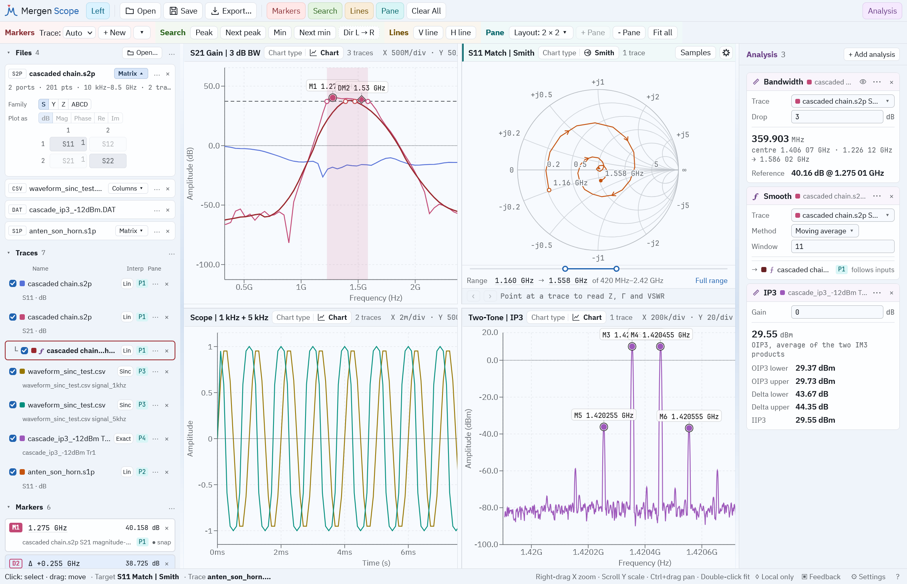

# Mergen Scope

<p>
  
</p>

[](LICENSE)

**A browser workspace for spectrum analyzer, scope and S-parameter files. Your files stay in your browser.**

[**Try the demo**](https://mergenscope.com/app.html?demo=1) · [**Open the app**](https://mergenscope.com/app.html) · [User guide](https://mergenscope.com/guide/) · [Sample files](test%20files/) · [Feedback](https://github.com/AlpGoXd/mergen-scope/discussions)



## Try it in 30 seconds

1. Download a file from [`test files/`](test%20files/), for example `cascaded chain.s2p` or `scope_1khz_sine_100ksps.csv`.
2. [Open the app](https://mergenscope.com/app.html).
3. Drop the file into the workspace and place a marker on the trace.

No file at hand? [Load the demo workspace](https://mergenscope.com/app.html?demo=1).

## Supported files

| Format | What you get | Tested with |
| --- | --- | --- |
| R&S `.dat` | Spectrum traces with span, RBW and detector metadata. Amplitude-only exports rebuild the X axis from Start/Stop. | R&S FSVA3044 exports (`cascade_ip3_*.DAT`) |
| `.csv`, `.tsv`, `.txt`, tabular `.dat` | Time or frequency traces. An import wizard maps delimiter, header rows, X/Y columns, multipliers and units. | Oscilloscope CSVs (`scope_1khz_sine_100ksps.csv`) |
| Touchstone `.s1p` to `.sNp` (1.x and 2.0) | S-parameter networks in RI, MA or dB/angle form, with S, Y, Z and (two-port) ABCD views, VSWR, return loss, group delay and a Smith chart. | `cascaded chain.s2p` |
| Workspace `.json` | A saved session: data, panes, markers, lines and analyses. | Round trip in the unit tests |

R&S `.dat` is the primary tested instrument path. Generic tables may need manual column and unit mapping.

## What you can measure

- **Markers and lines:** normal and delta markers, peak and minimum search, tone roles for IP3, and reference lines that list their intersections with traces.
- **Spectrum and RF:** harmonics (THD, SFDR), IP3, noise PSD, occupied bandwidth and channel power.
- **Time domain:** frequency, period, levels, RMS, rise/fall time, overshoot and duty cycle; resample; FFT with windows, averaging and max hold.
- **Networks:** Smith chart with impedance, admittance, VSWR and return-loss readouts; two-port stability and reciprocity/isolation.
- **Trace math:** offset/scale, smoothing (moving average, median, Savitzky-Golay) and add, subtract, multiply or divide of two traces.
- **Workspace:** up to four panes (experimental eight), linked X axes, undo/redo, save/restore as JSON, CSV export.

A typical chain: `Time capture -> Resample if needed -> FFT -> Harmonics / Peak Table / Channel power`.

Each tool states when it cannot use the selected data. FFT needs evenly spaced time samples, Channel power needs density units such as `dBm/Hz`, and the network cards need a two-port. SNR, SINAD, ENOB and THD+N need the window and noise-bandwidth information that only the app's own FFT spectra carry, so they are not reported for ordinary analyzer traces.

## Privacy

Files are read and processed in your browser. Nothing is uploaded, and there is no account.
Appearance preferences stay in the browser; a workspace is only saved when you download it.
Anything you attach to a GitHub issue is public, so share only data you are allowed to share.

## Feedback

- **Bug, file that will not open, missing measurement, or feature request:** [open an issue](https://github.com/AlpGoXd/mergen-scope/issues/new/choose) and pick the matching form. An example file or reproduction steps help most.
- **Questions and general feedback:** [Discussions](https://github.com/AlpGoXd/mergen-scope/discussions).
- **No GitHub account?** [Use the feedback form](https://tally.so/r/jeoN9x?src=readme).
- Attachments on GitHub issues are public.

## Why I built this

Mergen Scope started as the data viewer for [Mergen-21](https://github.com/AlpGoXd/mergen-21), my graduation project: a low-cost 21 cm hydrogen-line radio telescope that made its first on-sky H I detection in April 2026. I wanted one place to open spectrum analyzer sweeps, scope captures and VNA files from the bench without installing anything or moving data off my machine. It grew into a general RF measurement workspace.

<details>
<summary><strong>Development</strong></summary>

### Setup

Use Node.js 22.13+ on the 22.x line, or Node.js 24+, with npm. In a fresh clone:

```bash
git clone https://github.com/AlpGoXd/mergen-scope.git
cd mergen-scope
npm ci
npm run dev
```

Open **http://localhost:5173/app.html** for the app. The root URL serves the landing page; `app.html?demo=1` loads the demo session. Run `npm ci` only in a fresh checkout without `node_modules`. Install the Playwright browser once with `npx playwright install chromium`.

### Scripts

| Command | Purpose |
| --- | --- |
| `npm run dev` | Start the Vite development server |
| `npm run typecheck` | Check the strict TypeScript source |
| `npm run test:unit` | Run Vitest unit and component tests |
| `npm run test:watch` | Run Vitest in watch mode |
| `npm run test:e2e` | Run Playwright tests against the development app |
| `npm run build` | Typecheck and build the production site into `dist/` |
| `npm run test:static` | Test the built site using Vite preview; run after building |
| `npm run preview` | Serve the production build locally |

The production build bundles scripts and styles into `dist/app.html`, next to the static landing page, fonts, demo data and images. Nothing is loaded from a CDN.

### Codebase

React 19, TypeScript 6 (strict), Vite 7 and Recharts 2. Tests use Vitest, Testing Library and Playwright.

```text
index.html                  Static landing page
app.html                    Application entry page
src/
  App.tsx                   Application shell and panel wiring
  components/
    layout/                 Top bar, tool groups, side panels, and footer
    chart/                  Cartesian plots, pane layouts, and settings
    smith/                  Smith pane and frequency-range controls
    sidebar/                Trace, marker, line, and network controls
    analysis/               Analysis cards and shared panel UI
    wizard/                 Tabular import configuration and preview
    settings/               Browser-local appearance preferences
    help/                   Help and shortcut reference
  domain/
    parsers/                Format detection, R&S, tabular, and Touchstone parsing
    analysis/               Measurement functions and analysis tool registry
    smith/                  Smith geometry, hit testing, and readouts
    touchstone/             Network selections and ABCD conversion
    workspace-*             Workspace serialization and migrations
    transaction-history.ts  Undo/redo history
  hooks/                    UI and domain integration
  stores/                   Aggregate workspace state and React store adapters
  types/                    Shared TypeScript data contracts
  demo/                     Demo workspace loading
tests/
  unit/                     Domain, state, and component tests
  e2e/                      Browser interaction and workflow tests
  static/                   Built-site checks
```

The aggregate workspace provider coordinates changes across files, traces, panes, markers, lines and analyses so related edits undo together. Domain functions handle parsing, calculations, trace alignment and workspace migration separately from the UI. Saved workspaces are version 5; older formats are migrated on load.

### Current scope

- Chart and Smith panes exist. Table, polar, eye and spectrogram views are marked as planned.
- Network input is S-parameter Touchstone data. Stability and reciprocity/isolation are two-port only.
- FFT, Waveform and Harmonics run on the main thread, so very large captures can be slow.
- Live instrument connections and PWA installation are not implemented.

### Contributing

Issues and pull requests are welcome. Before opening a PR, run typecheck, unit tests, browser tests, build and static tests in that order, and add focused coverage when changing parsers, calculations, workspace persistence or history. Follow [AGENTS.md](AGENTS.md); the design requirements are in [design decisions](docs/design/design-decisions-2026-11-10.md) and the remaining work is in [the plan](docs/plan.md).

</details>

## License and contact

[Apache-2.0](LICENSE).

**Alp Gokalp**, RF/Microwave Engineering, Analog IC Design<br>
[GitHub](https://github.com/alpgoxd) · [alpgokalp@hotmail.com.tr](mailto:alpgokalp@hotmail.com.tr)
