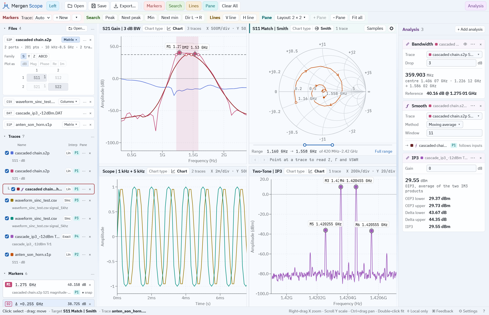

# Mergen Scope

<p>
  
</p>

[](LICENSE)

**A browser workspace for RF, waveform, and network measurements.**

Mergen Scope opens instrument exports and turns them into an interactive workspace for comparing traces, placing markers, measuring signals, and creating derived data. Spectrum analyzer captures, oscilloscope waveforms, and Touchstone networks can live in the same session, with compatible traces arranged across multiple panes.

Version 2.0 is a complete TypeScript rewrite with a redesigned interface, flexible pane layouts, an interactive Smith chart, a unified analysis panel, and workspace undo/redo. It has grown from a spectrum file viewer into a measurement workbench.

Files are read and processed in your browser. No account, measurement upload, or desktop installation is required.

[**Open the app**](https://mergenscope.com/app.html) · [**Try the demo workspace**](https://mergenscope.com/app.html?demo=1) · [Website](https://mergenscope.com/)



## The workspace

- **Multiple files and traces.** Compare measurements, rename traces, change colours and symbols, and manage visibility from file cards in the left panel.
- **Flexible panes.** Use rows, columns, a 2 × 2 grid, or one large pane with smaller panes beside it. Resize and rearrange panes, show a trace in more than one pane, and link compatible X axes while keeping Y controls independent.
- **Chart and Smith views.** Plot scalar traces on Cartesian axes or inspect network reflections on a Smith chart. Pane settings control grids, samples, marker tags, reference lines, and chart type.
- **Markers and search.** Place normal and delta markers, edit their positions, find peaks and minima, and assign tone roles for IP3 measurements.
- **Reference lines.** Add horizontal and vertical lines, choose which panes show them, and list their intersections with traces.
- **Analysis cards.** Add measurements and trace transformations from one searchable panel. Keep several cards open, with their settings, results, and chart overlays together.
- **Undo and redo.** Recover workspace edits with `Ctrl+Z` and redo with `Ctrl+Y` or `Ctrl+Shift+Z`.
- **Appearance and controls.** Light, dark, and system themes; three interface sizes; a colour-blind-safe palette; trace symbols; resizable side panels; and in-app help.

The normal limit is four panes. Settings offers an experimental eight-pane mode; layouts above four panes use rows or columns.

## Supported data

| Input | What opens |
| --- | --- |
| R&S `.dat` exports | Spectrum traces with instrument metadata such as frequency span, RBW, and detector. Amplitude-only exports can reconstruct the X axis from Start/Stop metadata. |
| `.csv`, `.tsv`, `.txt`, and tabular `.dat` | Time or frequency traces from delimited columns. The import wizard handles delimiter, header rows, X/Y columns, multipliers, and units. |
| Touchstone `.s1p` through `.sNp` | Multiport S-parameter networks in real/imaginary, magnitude/angle, or dB/angle form. Touchstone 1.x and 2.0 parsing is supported. |
| Workspace `.json` | A saved Mergen Scope session, including its measurement data and workspace configuration. |

For Touchstone data, the file card includes a matrix picker for adding parameter views. S, Y, and Z families are available, with ABCD conversion for two-port networks. Views include dB, magnitude, phase, real, and imaginary components where applicable, plus VSWR, return loss, and group delay for appropriate S-parameters. Input files must contain S-parameters; Y, Z, and ABCD are calculated from that network.

The Smith pane accepts reflection parameters such as S11 and S22. It includes impedance/admittance grids, frequency-range selection, direction indicators, and marker readouts for impedance, admittance, reflection coefficient, VSWR, and return loss.

## Analysis and trace processing

Select a trace, open **Analysis**, and choose **+ Add analysis**. The menu distinguishes **Measure** tools from **Math** tools and explains when a tool cannot use the selected data.

| Area | Available tools |
| --- | --- |
| General measurements | Peak Table, Range Statistics, Bandwidth, Threshold crossings, Ripple, and reference-line crossing lists |
| Spectrum and RF | Harmonics, Noise PSD, IP3, Occupied bandwidth, and Channel power |
| Time domain | Waveform measurements, FFT, and Resample |
| Network | Two-port Stability and Reciprocity / Isolation |
| Trace processing | Offset / Scale, Smooth, and Trace math |

**Math cards create derived traces.** Offset / Scale applies constants; Smooth offers moving average, median, and Savitzky–Golay filters. Trace math adds, subtracts, multiplies, or divides two traces, with controls for the sample grid and filling gaps when their X values differ.

**Waveform** measures frequency, period, levels, mean, RMS, rise/fall time, overshoot, and duty cycle. **Resample** makes an evenly spaced time trace using linear or cubic-spline interpolation. **FFT** creates a single-sided RMS spectrum with selectable windows, point counts, detrending, averaging or max hold, and amplitude or density scales.

A typical workflow is:

```text
Time capture -> Resample if needed -> FFT -> Harmonics / Peak Table / Channel power
```

**Harmonics** reports the fundamental, harmonics, THD, and SFDR. Noise-dependent results such as SNR, SINAD, ENOB, and THD+N require the window and noise-bandwidth information carried by spectra created with the app's FFT; these results are not reported for ordinary analyzer traces.

Measurements respect their data requirements: FFT needs evenly spaced time samples, Channel power needs spectral-density units such as `dBm/Hz` or `dBW/Hz`, Noise PSD estimates density using the trace sample spacing, and the network measurement cards require a two-port network.

## Getting started

1. [Open the app](https://mergenscope.com/app.html) and choose **Load demo** in the empty left panel, or [open the demo directly](https://mergenscope.com/app.html?demo=1).
2. To use your own measurements, drag files into the workspace or use **Open** in the left panel. Confirm column mappings in the import wizard when prompted. The top-bar **Open** button loads a saved workspace JSON.
3. Select a trace in the left panel. Use its pane controls or drag it to a pane to arrange comparisons. Time and frequency data stay in compatible panes.
4. Enable **Markers**, **Search**, **Lines**, or **Pane** in the top bar to show the corresponding tools. Use **Pane** to add panes and choose a layout.
5. Add analysis cards, then use **Save** to download the session as a portable JSON file.

For chart navigation, right-drag to zoom an X range, scroll to scale Y, Shift+scroll to offset Y, Ctrl+scroll to zoom X around the cursor, and Ctrl+drag or middle-drag to pan. Double-click or press `F` to fit all. In a Smith pane, scrolling zooms both axes. Open **?** in the footer for help.

### Saving and sharing

- **Save** downloads a version 5 workspace JSON containing imported data, derived traces, analysis instances and results, pane layout and settings, zoom state, markers, reference lines, and trace assignments. Older workspace formats are migrated on load.
- **Open** in the top bar restores a workspace. Workspace JSON files can also be dropped into the app. Loading a workspace asks before replacing an existing session.
- **Export…** in the top bar downloads visible traces as CSV. A pane's settings also offers CSV export for its traces.
- **Copy chart** in a Cartesian pane's settings copies its plot as a PNG image when the browser supports clipboard image writing.

Appearance preferences are saved in the browser separately from workspace files. Save a workspace JSON to keep or share your measurement session.

## Local development

Use Node.js 22.13+ on the 22.x line, or Node.js 24+, with npm. In a fresh clone:

```bash
git clone https://github.com/AlpGoXd/mergen-scope.git
cd mergen-scope
npm ci
npm run dev
```

Open **http://localhost:5173/app.html** for the application. The root URL serves the landing page; `app.html?demo=1` loads the demo session.

Run `npm ci` only in a fresh checkout without an existing `node_modules` directory. See [AGENTS.md](AGENTS.md) for repository safety and collaboration rules.

| Command | Purpose |
| --- | --- |
| `npm run dev` | Start the Vite development server |
| `npm run typecheck` | Check the strict TypeScript source |
| `npm run test:unit` | Run Vitest unit and component tests |
| `npm run test:watch` | Run Vitest in watch mode |
| `npm run test:e2e` | Run Playwright tests against the development app |
| `npm run build` | Typecheck and build the production site into `dist/` |
| `npm run test:static` | Test the built site using Vite preview; run after building |
| `npm run preview` | Serve the production build locally |

Install the test browser once before running Playwright:

```bash
npx playwright install chromium
```

The production build bundles the React application's scripts and styles into `dist/app.html`, alongside the static landing page, fonts, demo data, and image assets. Runtime assets are served locally rather than loaded from a CDN.

## Codebase

The application uses **React 19, TypeScript 6 in strict mode, Vite 7, and Recharts 2**. Smith rendering and network calculations live in dedicated modules. Tests use Vitest, Testing Library, and Playwright.

```text
index.html                  Static landing page
app.html                    Application entry page
src/
  App.tsx                   Application shell and panel wiring
  components/
    layout/                 Top bar, tool groups, side panels, and footer
    chart/                  Cartesian plots, pane layouts, and settings
    smith/                  Smith pane and frequency-range controls
    sidebar/                Trace, marker, line, and network controls
    analysis/               Analysis cards and shared panel UI
    wizard/                 Tabular import configuration and preview
    settings/               Browser-local appearance preferences
    help/                   Help and shortcut reference
  domain/
    parsers/                Format detection, R&S, tabular, and Touchstone parsing
    analysis/               Measurement functions and analysis tool registry
    smith/                  Smith geometry, hit testing, and readouts
    touchstone/             Network selections and ABCD conversion
    workspace-*             Workspace serialization and migrations
    transaction-history.ts  Undo/redo history
  hooks/                    UI and domain integration
  stores/                   Aggregate workspace state and React store adapters
  types/                    Shared TypeScript data contracts
  demo/                     Demo workspace loading
tests/
  unit/                     Domain, state, and component tests
  e2e/                      Browser interaction and workflow tests
  static/                   Built-site checks
```

The aggregate workspace provider coordinates changes across files, traces, panes, markers, lines, and analyses so related edits can be undone together. Store adapters expose those slices to components. Domain functions handle parsing, calculations, trace alignment, and workspace migration separately from the UI.

## Current scope

- R&S `.dat` is the primary tested instrument export path; generic tables may need manual column and unit mapping.
- Chart and Smith panes are available. Table, polar, eye, and spectrogram views are marked as planned in the pane picker.
- Network input is S-parameter Touchstone data. Stability and reciprocity/isolation measurements are two-port only.
- Large captures can stress browser rendering and calculations. FFT, Waveform, and Harmonics currently run on the main thread.
- The app works with imported files and saved sessions. Live instrument connections and PWA installation are not implemented.

## Contributing

Issues and pull requests are welcome. Include an example file or reproduction steps when reporting an import or analysis problem. The in-app **Feedback** menu opens GitHub issue forms with the app version and browser details, without attaching measurement files.

For code changes, run typecheck, unit tests, browser tests, build, and static tests in that order. Add focused coverage when changing parsers, calculations, workspace persistence, or history. Follow [AGENTS.md](AGENTS.md); the redesign checkpoint is documented in [docs/redesign/CHECKPOINT.md](docs/redesign/CHECKPOINT.md).

## Why I built this

I'm an EE engineer, and I wanted a practical way to inspect measurement files without setting up a heavy desktop tool. Mergen Scope started with spectrum analyzer exports; the rewrite brings waveform and network work into the same browser workspace.

The goal is to open real measurements quickly, make comparisons and calculations easy to inspect, and keep the source understandable enough for other engineers to improve it.

## License and contact

[Apache-2.0](LICENSE).

**Alp Gokalp** — RF/Microwave Engineering, Analog IC Design<br>
[GitHub](https://github.com/alpgoxd) · [alpgokalp@hotmail.com.tr](mailto:alpgokalp@hotmail.com.tr)
