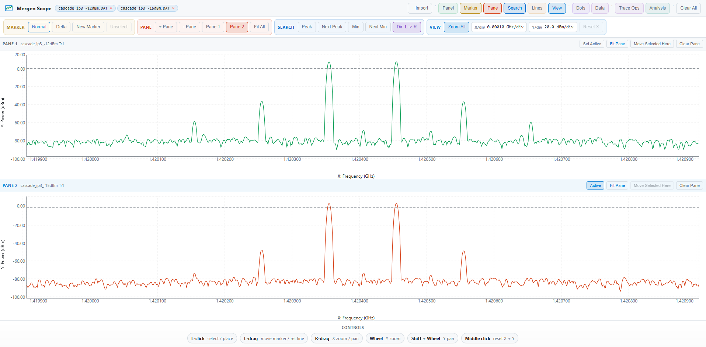

# Mergen Scope

<p>
  
</p>

[](https://mergenscope.com/)
[](LICENSE)

Mergen Scope is a free, open-source, browser-based RF and signal analysis workspace. It opens Rohde & Schwarz spectrum analyzer `.dat` exports, generic tabular `.csv` / `.txt` data, and Touchstone `.sNp` network files, then gives you interactive plotting, trace operations, RF measurement helpers, workspace save/load, and chart/data export without installing desktop software.

[**Open the viewer**](https://mergenscope.com/) · [Load the demo](https://mergenscope.com/app.html?demo=default)



---

## What It Does

- Opens R&S spectrum analyzer `.dat` files, generic CSV/TSV/TXT/DAT tables, and Touchstone `.s1p` through `.sNp` files.
- Uses an import wizard for ambiguous tabular files, including delimiter, skipped rows, X/Y columns, and time/frequency domain selection.
- Loads multiple files and multiple traces into one workspace.
- Compares traces in up to 4 stacked panes with shared X navigation and pane-local Y scaling.
- Keeps frequency-domain and time-domain traces separated so mixed data does not end up on the same pane by accident.
- Adds normal markers, delta markers, peak search, next-peak search, minima search, and marker role assignment for IP3 / TOI.
- Adds vertical and horizontal reference lines, including pane-local lines and linked lines across panes.- Builds derived traces with offset, scale, smoothing, trace math, Noise PSD, and Touchstone stability metrics.
- Exports visible traces as CSV, complete workspaces as JSON, and chart views as PNG / SVG.
- Runs as a local browser app with bundled runtime assets and no CDN calls from the production page.

---

## Analysis Tools

Mergen Scope has grown from a simple file viewer into a small measurement workbench. Current analysis cards include:

| Area | Tools |
|------|-------|
| Spectrum | Noise PSD, IP3 / TOI, occupied bandwidth, guarded channel power |
| General trace analysis | Peak table, range statistics, 3 dB / 10 dB bandwidth, threshold crossings, ripple / flatness |
| Touchstone / network | VSWR, return loss, group delay, reciprocity / isolation, 2-port stability |
| Touchstone derived traces | `K`, `mu1`, `mu2`, `|delta|` |

Group delay is computed from complex S-parameter data using unwrapped phase and finite differences. Low-magnitude regions are masked to avoid unstable phase-derivative spikes.

Channel power is intentionally gated to spectral-density units such as `dBm/Hz` or `dBW/Hz`, because integrating ordinary amplitude traces would produce misleading results.

---

## Supported File Formats

| Format | Notes |
|--------|-------|
| R&S semicolon-delimited `.dat` | Primary tested spectrum analyzer export path |
| Amplitude-only `.dat` | Frequency axis can be reconstructed from Start/Stop metadata |
| Generic `.csv`, `.txt`, `.dat` tables | Import wizard supports comma, semicolon, and tab-delimited files |
| Touchstone `.s1p` to `.sNp` | S/Y/Z trace workflows, Smith chart view, and network analysis |

Typical R&S semicolon-delimited export:

```text
; R&S Export
Values;1001
StartXAxis;1000000;Hz
StopXAxis;3000000000;Hz
RBW;3000;Hz

Trace 1;
Trace Mode;CLR/WR
Detector;RMS
1000000;-80.5
1030000;-79.2
...
```

---

## Usage

### Load Data

Open the viewer, then drag a supported data file onto the chart area or use **Import / Export -> Import Data Files**. Ambiguous tabular files open the import wizard so you can confirm the delimiter, header rows, X column, Y columns, multipliers, and domain.

### Work With Traces

Use the sidebar to show, hide, select, and move traces. Drag traces between pane headers or pane bodies to compare them in different panes. The app keeps panes domain-compatible, so a time waveform and an RF spectrum will be split instead of overlaid.

### Markers And Reference Lines

Use marker tools to place normal or delta markers, snap to peaks/minima, and select the marker trace. Use line tools to add vertical or horizontal reference lines. Reference lines can stay pane-local or be locked across panes.

### Trace Ops

Open **Trace Ops** to create derived traces:

- **Offset** adds a constant value.
- **Scale** multiplies by a constant factor.
- **Smoothing** supports moving average, median filter, and Savitzky-Golay.
- **Trace Math** supports `A + B`, `A - B`, `A * B`, and `A / B`.

Trace Math operates over the overlapping X range, uses trace A's grid, and offers interpolation modes: Auto, Exact only, Linear, Nearest, Previous, Next, and Cubic spline. Logarithmic-unit warnings are shown as notes; the app does not silently convert or reinterpret units.

### Save And Export

Use **Save Workspace** to export a portable JSON session containing imported files, traces, pane layout, zoom state, markers, reference lines, and saved analysis results.

Use **Load Workspace** to restore a saved session. Use **Export Visible CSV** for the traces currently visible in the workspace. Use **PNG** or **SVG** to capture the current chart.

---

## Local Development

```bash
git clone https://github.com/AlpGoXd/mergen-scope.git
cd mergen-scope
npm install
npm run dev
```

Then open `http://localhost:5173/` in your browser.

Useful scripts:

```bash
npm run typecheck
npm run test:unit
npm run test:e2e
npm run test:static
npm run build
```

`npm run build` writes the production bundle to `dist/`.

---

## Deployment

Production URL: <https://mergenscope.com>

Legacy GitHub Pages URL: <https://alpgoxd.github.io/mergen-scope/>

Cloudflare Workers / Pages settings:

- Build command: `npm run build:cloudflare`
- Deploy command: `npx wrangler deploy`

GitHub Pages deployment is also wired through `.github/workflows/deploy-pages.yml` for the legacy project URL.

---

## Architecture

### Tech Stack

| Layer | Technology |
|-------|------------|
| Framework | React 19 |
| Language | TypeScript 6, strict mode |
| Build | Vite 7 + vite-plugin-singlefile |
| Charts | Recharts 2 |
| State | React context + reducer stores |
| Tests | Vitest, Testing Library, Playwright |
| Deployment | Cloudflare static assets plus legacy GitHub Pages |

### Entry Points

- `index.html` - static landing page.
- `app.html` - React SPA shell that mounts `<div id="root">`.
- `src/main.tsx` - React bootstrap and store provider setup.

### Source Layout

```text
src/
  components/
    analysis/      Spectrum, shared, and Touchstone analysis cards
    chart/         Cartesian panes, Smith chart, pane settings
    layout/        Top bar, toolbar strip, sidebars, status/footer bars
    panels/        Import/export and data table panels
    sidebar/       Trace, marker, reference-line, and Touchstone controls
    wizard/        Tabular import wizard
  demo/            Demo workspace loader
  domain/
    analysis/      Pure measurement functions and registry
    parsers/       R&S DAT, Touchstone, tabular, and format classifier
    trace-ops.ts   Derived trace creation, smoothing, and binary math
    trace-math.ts  Interpolation and point math
    ref-lines.ts   Reference-line intersections and linked-line logic
    workspace-*    JSON save/load and migrations
  hooks/           UI/domain bridge hooks
  stores/          Context-backed reducer stores
  types/           Shared TypeScript contracts
```

### State Model

Stores are composed in `StoreRoot.tsx`:

```text
UiStore -> AnalysisStore -> MarkerStore -> RefLineStore
        -> FileStore -> TraceStore -> PaneStore -> <App />
```

There is no global singleton. Each store is a provider, and components subscribe only to the slices they need.

### Parser Pipeline

```text
file drop / open
  -> parse-file.ts      format detection by filename and content heuristics
      -> rs-dat.ts      R&S semicolon-delimited .dat
      -> touchstone.ts  .s1p-.sNp network data
      -> tabular.ts     CSV/TSV/TXT/DAT column data
          -> ImportWizardModal when confidence is low or user import is explicit
```

### Workspace Versioning

Saved sessions are v4 JSON snapshots. `workspace-migrate-v4.ts` upgrades older snapshots on load. The current format includes imported files, raw traces, derived traces, pane layout, zoom state, marker state, reference lines, and saved analysis results.

---

## Current Limitations

- R&S `.dat` exports are the best-tested instrument path.
- Generic tabular files depend on the import wizard configuration and may need manual column selection.
- Multi-pane is limited to 1 to 4 stacked panes.
- Touchstone stability metrics are currently 2-port only.
- Smith chart workflows still need more real-world test coverage.
- Large trace files can still stress the browser charting layer.
- PWA/offline install support is not implemented yet.

---

## Roadmap

Completed:

- TypeScript + Vite migration.
- Multi-pane workspace.
- Import/export and portable workspaces.
- Expanded RF analysis cards.
- Touchstone import and network analysis.
- CSV/tabular import wizard.
- Unit, static, and e2e test scaffolding.

Next:

1. Performance pass for larger traces.
2. More oscilloscope/waveform import coverage.
3. More Touchstone edge-case validation.
4. Smith chart polish.
5. Better public examples and screenshots.

---

## Why I Built This

I'm an EE engineer. I wanted a practical way to inspect spectrum analyzer exports, Touchstone files, and simple instrument tables directly in the browser. The early version was a tiny viewer; the current version is closer to a lightweight RF/signal analysis workspace.

The goal is still the same: open real measurement files quickly, avoid heavy desktop setup, and keep the tool understandable enough that other engineers can improve it.

---

## Contributing

Open an issue or submit a pull request. Please run `npm run build` before submitting larger changes, and include focused tests when touching parsers, trace math, workspace serialization, or analysis functions.

---

## License

Apache-2.0. See [LICENSE](LICENSE).

---

## Contact

**Alp Gokalp** - RF/Microwave Engineering, Analog IC Design

[GitHub](https://github.com/alpgoxd) | [alpgokalp@hotmail.com.tr](mailto:alpgokalp@hotmail.com.tr)
